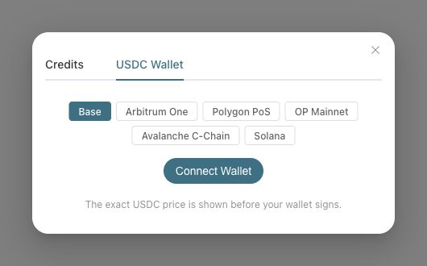

# Studio X402 EVM networks

Studio's order checkout and fixed-price scenario wallet dialog support the
networks below. The payment request must include an `exact` quote for the selected
network. A missing quote stops payment; Studio never chooses another chain.

| Network | Alias | CAIP-2 | USDC |
| --- | --- | --- | --- |
| Arbitrum One | `arbitrum` | `eip155:42161` | Native Circle USDC |
| Polygon PoS | `polygon` | `eip155:137` | Native Circle USDC |
| OP Mainnet | `optimism` | `eip155:10` | Native Circle USDC |
| Avalanche C-Chain | `avalanche` | `eip155:43114` | Native Circle USDC |

The wallet dialog uses the selected network for injected wallets and WalletConnect.
It rechecks a completed network switch and checks the wallet chain again immediately
before requesting a payment signature. Switching the selected rail clears the old
connection. Account events from disconnected providers cannot restore that connection.
Payment records link to the selected chain's explorer.

New EVM rails cover fixed-price APIs and order payments. Chat continues to require
an explicitly selected Solana recurring authorization; selecting an EVM rail must
not silently charge an existing Solana authorization. EVM choices are disabled in
the chat wallet dialog.

Phantom's injected-wallet support table lists Arbitrum and Polygon. For Optimism
and Avalanche use a wallet that supports the target chain, such as Rabby or MetaMask.
An EVM address can be shared across chains, but balances are separate. Use an EVM
address for EVM USDC, not the Solana address from the same wallet application.

This client change does not enable production payments. The matching Facilitator,
Gateway and PlatformBackend rail must be configured and enabled. Before activation,
perform an explicitly authorized small payment and verify the on-chain receipt,
recipient, settlement status and recovery. No real payment was made for these PRs.

Validation: `npm run test:run`, `npm run build`, `python3 -m unittest`, and
`python3 scripts/check_i18n_coverage.py`. New labels are network proper names and
reuse existing localized wallet controls; no new translation keys are introduced.

## Per-network feature gates

New rails are hidden by default in both order checkout and Studio. Opt in with
`?features=x402-arbitrum` (use the matching alias for each supported network).
Multiple flags are comma-separated; `?features=-x402-arbitrum` explicitly turns
that rail off, including when `all` is on. `features=none`
clears host-local overrides. Use the flag on each frontend host separately.
The existing host-only feature cookie keeps the opt-in through navigation.

The flags are frontend-only and are not sent in payment or config request headers.
No backend FeatureFlag rows or migrations are required. Cached quotes and wallet
state do not bypass a disabled UI gate. Receipt history remains readable.
This is a preview/rollout gate: it cannot enable an unconfigured service rail,
change pricing or skip signature verification. Direct API/SDK operational
availability still follows Gateway/Facilitator configuration.

## Component preview

Local preview with all four new chain flags enabled; production availability still comes from the server quote.

